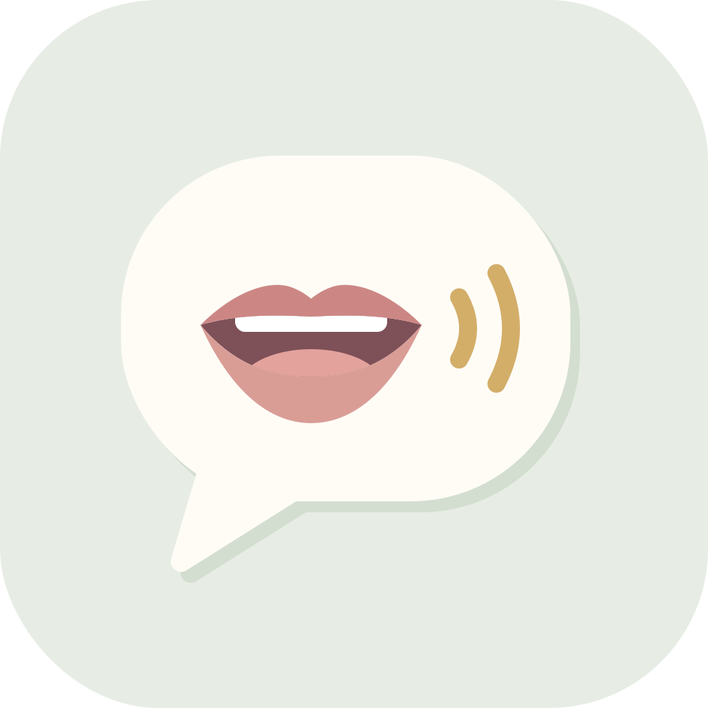
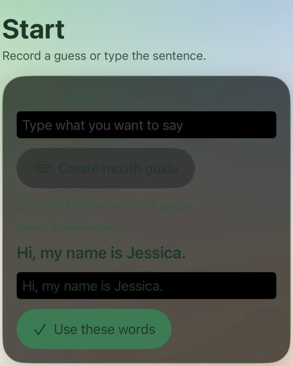
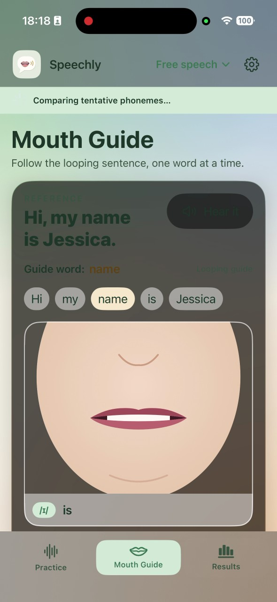
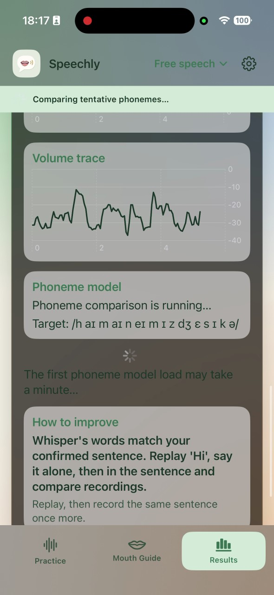
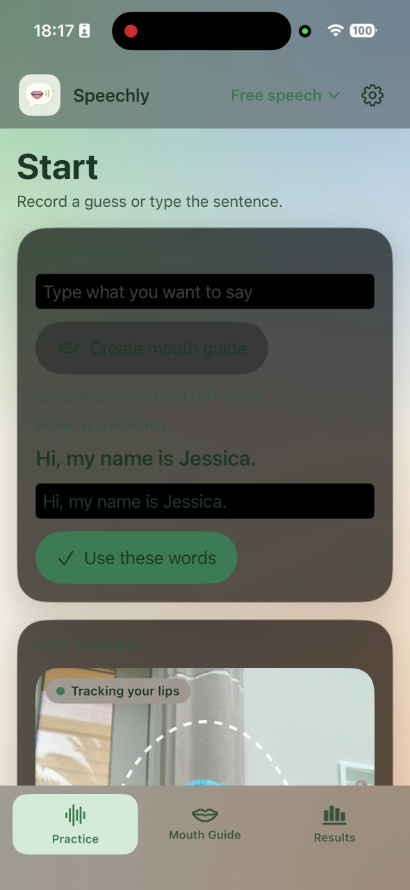
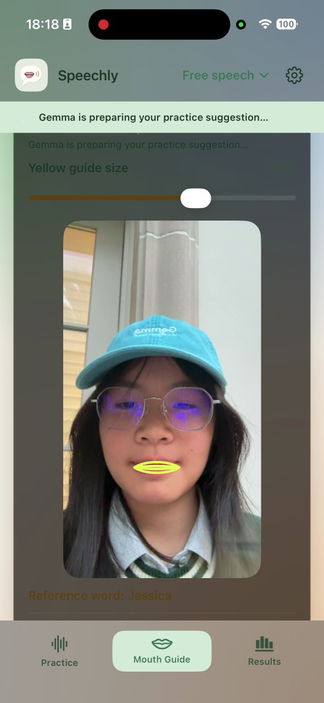
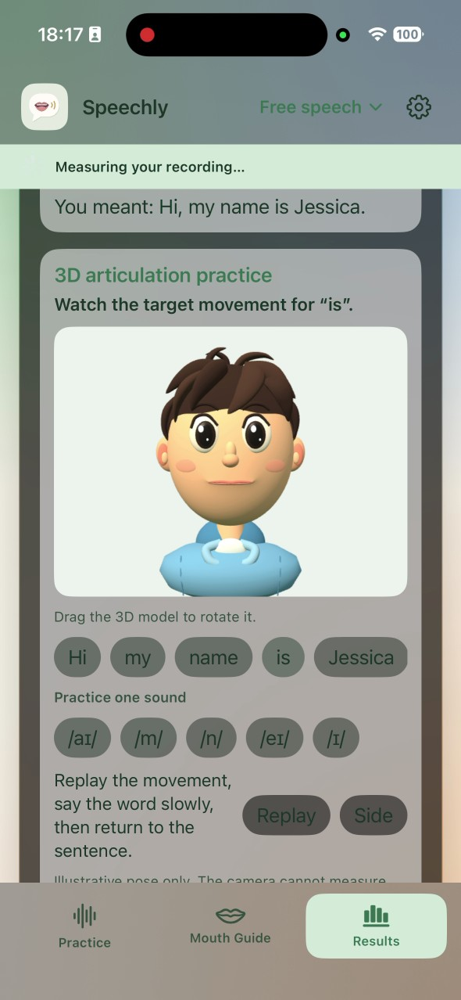
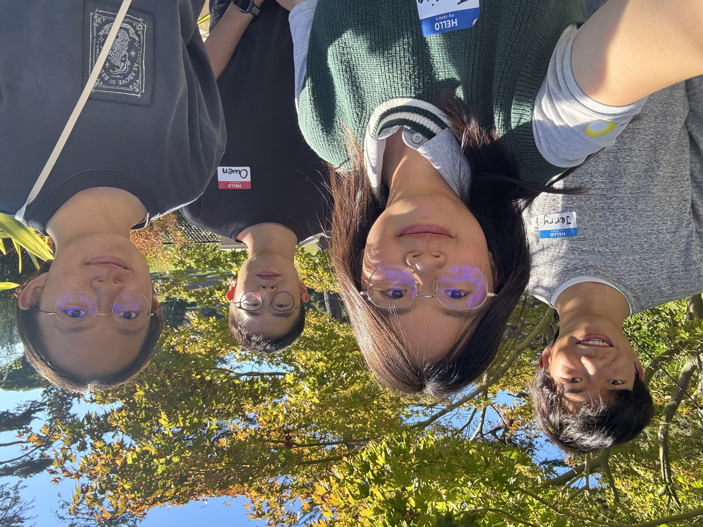
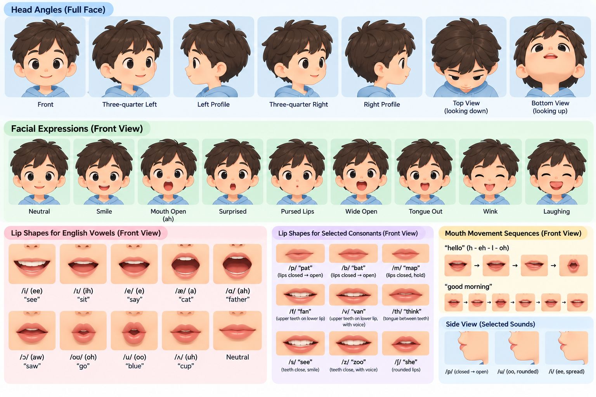
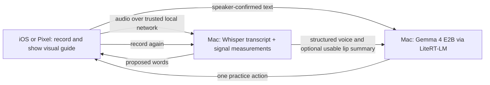

# Speechly



**Website:** [Speechly product site](https://speechlyweb.netlify.app/) — the story, complete practice flow, team, and interactive 3D guide.

**Hugging Face:** [Our profile](https://huggingface.co/Jessicaaaaaaaaa) · [Speechly's fine-tuned phoneme adapter and model card](https://huggingface.co/Jessicaaaaaaaaa/l2-arctic-perceived-phoneme-ctc)

> **Built with LiteRT-LM.** Speechly runs **Gemma 4 E2B locally on the Mac through LiteRT-LM**. The iOS and Pixel apps record speech and show the practice guide; the Mac service loads the `.litertlm` model, uses the GPU backend by default, and returns one suggestion based on speaker-confirmed words and measured signals. The model does not run in the phone apps or the website's browser preview.

> **Our fine-tuning.** We fine-tuned a Wav2Vec2 CTC phoneme recognizer on manually annotated L2-ARCTIC speech to study the sounds a speaker produced. The [published adapter and model card](https://huggingface.co/Jessicaaaaaaaaa/l2-arctic-perceived-phoneme-ctc) document the training and validation results. This experimental phoneme model is separate from Gemma; **we did not fine-tune Gemma**.

## Why Speechly matters

**Being understood changes what someone can do next.**

Speaking practice often relies on hearing your own voice and noticing what to change. Some people who are deaf or hard of hearing cannot rely on that feedback. Speech therapists and teachers provide essential support, but they cannot be present for every short practice attempt between sessions. Speechly's social purpose is to make part of that feedback visible so people can keep practicing at their own pace.

Imagine rehearsing a sentence before speaking in class, asking for help, or joining a conversation. You say it aloud, and a speech recognizer returns different words. The speaker knows what they meant; the model only has a guess. For people with speech disabilities, being misunderstood can make ordinary moments harder to enter. A practice tool should not turn that uncertainty into a verdict about the person.

Speechly gives that choice back to the speaker. They record a sentence, review what the model heard, and confirm their own words. A word-by-word mouth guide can be viewed alongside their lip movement. Voice measurements and a locally generated Gemma suggestion then turn the attempt into one concrete action to try next.

We are building for people who may benefit from visual cues and a private place to rehearse, including deaf and hard-of-hearing speakers, people with speech differences, and English learners. The social goal is to give more people tools to participate in everyday communication on their own terms. The current practice flow focuses on English; expanding the approach to more languages is a future direction. Speechly supports practice; it does not replace a speech-language professional or claim a clinical benefit that has not been demonstrated.

**Speak → See → Improve.** Record and confirm your words; follow a visual guide; review the evidence, practice one action, and try again.

The repository includes native iOS and Google Pixel apps, a browser-based lesson experience, and a Mac companion for local Whisper recognition, speech measurements, experimental phoneme comparison, and Gemma 4 E2B coaching through LiteRT-LM. The visual guide and model outputs are practice aids. Speechly does not diagnose, treat, or score a medical condition, and the prototype has not established clinical or pronunciation outcomes.

## Watch Speechly

Two real frames for each page of the native iPhone app show the full practice flow:

<table>
  <tr><th>1 · Practice</th><th>2 · Mouth Guide</th><th>3 · Results</th></tr>
  <tr>
    <td><strong>Confirm your words</strong><br></td>
    <td><strong>Follow the reference</strong><br></td>
    <td><strong>Review the evidence</strong><br></td>
  </tr>
  <tr>
    <td><strong>See your lips live</strong><br></td>
    <td><strong>Compare on your face</strong><br></td>
    <td><strong>Explore the 3D pose</strong><br></td>
  </tr>
</table>

[Watch the full 1:29 iPhone app recording](https://speechlyweb.netlify.app/assets/speechly-iphone-demo.mp4) · [Try the iOS browser view](https://speechlyweb.netlify.app/phone-demo.html?device=iphone) · [Try the Pixel browser view](https://speechlyweb.netlify.app/phone-demo.html?device=pixel)

The screenshots and recording show the native iPhone app. The iOS and Pixel links open the website's separate interactive browser preview.

## Images from the website



*The team behind Speechly.*



*Our visual exploration for the interactive articulation guide; these mouth shapes are illustrative.*

## The complete practice loop

1. **Speak and confirm.** Speak freely or choose a target word, then record or import audio. The web analysis prototype shows live microphone level and can optionally track visible lip movement with the camera. Whisper proposes a transcript; the speaker edits it to match what they intended to say. The model's guess never becomes the speaker's intention by default.
2. **See and feel the movement.** The confirmed sentence becomes a looping word-by-word mouth guide. A yellow outline shows the illustrative reference while a blue outline traces measured lip movement when the camera is on. On iOS and Pixel, optional light vibrations mark changes in the reference mouth movement, giving a tactile cue for the next mouth shape. The guide can be replayed slowly, viewed step by step, or used with preset word lessons. The vibrations follow the guide's timing; they do not judge pronunciation.
3. **Understand and retry.** The result separates model guesses from measured evidence: recording quality, duration, volume, pitch, and optional tentative phoneme comparison for single words. Gemma 4 E2B reads the confirmed words and structured measurements to suggest one practical next step. The speaker can replay, focus on a word, and record again.

In both native app modes, recording and live visual guidance run on the phone while a trusted-network Mac companion runs Whisper, the experimental phoneme model, and Gemma through LiteRT-LM. The separate browser lesson app also offers guided examples and demo feedback. Neither model output nor visual animation is a pronunciation score or diagnosis.

## iOS and Pixel app modes

Choose the native app for your phone:

- **iOS:** [SwiftUI app and setup](ios/README.md) for iPhone and iPad.
- **Google Pixel / Android:** [Kotlin and Jetpack Compose app and setup](android/README.md).

Both apps provide Practice, Mouth Guide, and Results pages. You can type a sentence to create a visual guide, or record speech and confirm the proposed words before reviewing measurements and a practice suggestion. Set up the shared [Mac analysis service](mac_service/README.md) and connect the phone to it on a trusted local network for Whisper and Gemma features. The model runs on the Mac, not on either phone. The [website's phone demo](https://speechlyweb.netlify.app/phone-demo.html) offers iOS and Pixel views of a separate browser preview.

### Where each step runs



The Mac runs the models locally; the phone and Mac still need a trusted local connection.

### LiteRT-LM implementation

The [Gemma coach](mac_service/src/speech_mirror/coach.py) creates a `litert_lm.Engine` from the local `.litertlm` model and selects the GPU backend by default; a CPU backend is configurable. The [analysis pipeline](mac_service/src/speech_mirror/pipeline.py) passes confirmed text and structured measurements to the coach and records inference time as `performance.gemma_ms`. See the [Mac service setup](mac_service/README.md) for the model download and launch commands.

### Why Gemma is in the loop

Whisper proposes words; it does not decide what the speaker meant. Confirmation can change the target from a mistaken transcript such as **“key”** to the intended **“tea”**. The [analysis pipeline](mac_service/src/speech_mirror/pipeline.py) combines that confirmed text with extracted timing, volume, pitch, and optional sufficiently tracked lip features. The [Gemma coach](mac_service/src/speech_mirror/coach.py) receives those structured values, not raw audio or video, and returns one practice focus and action. Weak evidence should produce a cautious response. The “key → tea” scene on the website is an illustrative preview, not a recorded case study or proof that a specific correction works.

## The data and models behind the practice loop

Whisper drafts the transcript, and the speaker confirms what they meant. The phoneme model has a separate research role: estimating the sounds produced in English read speech, not deciding the speaker's intended words.

### Our fine-tuned phoneme model

We started from [`facebook/wav2vec2-lv-60-espeak-cv-ft`](https://huggingface.co/facebook/wav2vec2-lv-60-espeak-cv-ft) and fine-tuned its top two acoustic transformer layers and CTC head for one epoch on 3,380 usable, manually annotated [L2-ARCTIC](https://psi.engr.tamu.edu/l2-arctic-corpus-docs/) utterances. Speakers were split between training, validation, and a reserved test set. On the 888-utterance validation split, phone error rate fell from **28.24% to 20.08%**; error-location precision rose from **17.20% to 25.98%**. These are validation results, not performance claims for new speakers or clinical use.

**What we published on Hugging Face:** The [model repository](https://huggingface.co/Jessicaaaaaaaaa/l2-arctic-perceived-phoneme-ctc) provides:

- **Adapter weights:** 102 MB covering the 34 tensors updated during fine-tuning, plus processor files. It includes no speech recordings or annotations.
- **Restoration instructions:** The model card and `restore_model.py` explain how to combine the adapter with the pinned Wav2Vec2 base checkpoint into a complete model of about 1.26 GB. The adapter alone is not a runnable full model.
- **Speechly setup:** Put the restored checkpoint at `mac_service/models/pronunciation/l2-arctic-ctc/best/` for the Mac service to use it. Without that checkpoint, the service uses the base phoneme model.

**Research limits:** The held-out test is unfinished, false alarms remain common, and the L2-ARCTIC data license restricts commercial use. This Hugging Face release is the experimental phoneme recognizer, not Gemma or the LiteRT-LM model.

Gemma 4 E2B has a different job. It runs **locally on the Mac through LiteRT-LM**, using the speaker-confirmed words and measured voice and lip signals to suggest one practical action to try next. We did not fine-tune Gemma. The phoneme checkpoint is not part of the current web experience and cannot support confident individual corrections or claims about people with speech disabilities.

## Browser lesson app: setup and run

Requires Node.js 20 or newer.

```bash
npm install
npm run dev        # http://127.0.0.1:5173
npm run build      # type-check and production build into dist/
npm run preview    # serve the production build at http://127.0.0.1:4173
npm test           # Playwright browser tests (starts the dev server automatically)
npm run lint
```

The browser lesson's demo flow needs no API keys, backend or network services. Fonts and icons are bundled locally. Camera and microphone access require
`localhost` or HTTPS.

## What works

- **Six preset lessons:** “me”, “moon”, “fish”, “pea”, “bee” and “See me.”, each with a pronunciation reference, explanation, visible
  target movement, practice tip, correction guide and demo feedback content.
- **SVG reference mouth** built from code-driven paths with seven reusable states (rest, closed, open, spread, rounded, lower lip
  to upper teeth, teeth together) and smooth interpolation along hand-authored timelines.
- **Playback controls:** play, pause/resume, replay, normal and slow speed, and a seekable progress bar.
- **Correction guidance mode** per lesson with a dashed target outline, highlighted lip regions, directional arrows and a short
  instruction, labeled as a general practice suggestion rather than an observation about the learner.
- **Step-by-step view** showing discrete mouth states with written captions. It turns on automatically when the system asks for
  reduced motion.
- **Optional reference audio** through a local `en-US` browser voice. If none is available, the page shows “Audio preview is
  unavailable on this device.”
- **Camera and microphone,** requested only when the user clicks: a mirrored preview with a positioning guide, separate camera
  and microphone status, and a live microphone level meter based on real measurements.
- **Recording:** start/stop, elapsed time, an automatic stop at 10 seconds, playback, and discard. Empty or very short
  recordings are flagged as unusable. Recordings stay in memory as object URLs, which are revoked on discard. Media tracks stop
  when they are turned off.
- **Graceful fallbacks:** denied permission, missing devices (including camera-only or microphone-only), and unsupported
  browsers all show a message plus **Try demo mode**.
- **Demo mode:** the whole flow (record, review, feedback, correction, retry) works without any permission.
- **Liquid Glass styling:** translucent, blurred surfaces with light-catching edges over a soft color backdrop, capsule controls and a floating header. It falls back to solid surfaces when the system asks for reduced transparency or the browser cannot blur.
- **Responsive layout:** lesson selector, reference and guide, practice, and feedback sit side by side on desktop and stack on
  mobile. Keyboard focus is visible and the page has a skip link.

## Local lip tracking

When the camera is on, MediaPipe Face Landmarker runs locally in the browser. `src/analysis/features.ts` measures visible lip opening, width, and movement; `src/analysis/summarize.ts` compares the attempt with the speaker's resting mouth. These approximate signals are not a pronunciation score. Teeth, tongue, sound, voicing, and accent are not assessed by the camera.

### Testing face tracking

`npm test` runs every test. The face-tracking tests also need a video of a face for Chromium's fake camera:

```bash
FACE_VIDEO=/path/to/face.y4m npm test
```

### Credits

- Face-frame normalization, lip landmark indices and speech-range trimming are ported from
  [cdiazcastilla/lip-reading-research](https://github.com/cdiazcastilla/lip-reading-research) (MIT).
- [MediaPipe Tasks Vision](https://github.com/google-ai-edge/mediapipe) Face Landmarker (Apache 2.0).
- [Visual Speech Recognition for Multiple Languages](https://github.com/mpc001/Visual_Speech_Recognition_for_Multiple_Languages)
  was evaluated but not embedded. Its weights are licensed for non-commercial research only, are 0.9–1.5 GB, need a GPU, and
  transcribe whole sentences. Landmark measurements suit single-word movement feedback better.

## Demonstration behaviors

Feedback comes from `demoFeedbackProvider` (`src/feedback/demoProvider.ts`), a deterministic script that **does not analyze
the recording**:

1. The first attempt in a lesson receives that lesson’s corrective suggestion (“Example 1 of 2”). Its next action opens the
   correction animation.
2. Later attempts show how the interface would acknowledge a change (“Example 2 of 2”). Its next action is “Try again.”

Every feedback view shows “Demo feedback. Your recording has not been automatically assessed.” The microphone measurement (signal
level only) is shown separately from the feedback. The app shows no scores, percentages or claims about tongue position.

## iOS app

`ios/` contains a native SwiftUI version for iPhone and iPad with three swipeable
Practice, Mouth Guide, and Results pages. Its English free speech flow uses the
included [Mac analysis service](mac_service/README.md) on port 8765. See
[ios/README.md](ios/README.md) for the Xcode and iPhone setup.

## Android app

`android/` contains a native Kotlin / Jetpack Compose version for Google Pixel.
It uses the same Mac analysis service and three-page English practice flow.
See [android/README.md](android/README.md) for Android Studio and Pixel setup.

## Reserved for later development in the browser lesson app

- Direct integration of the Mac speech-analysis service into this browser lesson app.
- Model inference directly on the phone, and any fine-tuning.
- User accounts, saved progress, and lesson authoring.
- Persisting or uploading recordings.

## Project structure

```
src/
  types.ts                 Lesson, keyframe, attempt and feedback types
  data/lessons.ts          Lesson content and animation timelines
  animation/               Mouth shape parameters, geometry, timeline playback, reduced-motion hook
  media/                   Camera/mic capture, recorder, demo recorder, audio level meter
  speech/                  Optional en-US browser voice
  feedback/                FeedbackProvider interface, demo provider, actionId → behavior map
  components/              LessonSelector, ReferenceMouth, MouthIllustration, CorrectionOverlay,
                           CameraPreview, RecorderControls, AudioPlayback, FeedbackPanel, ...
e2e/                       Playwright tests (fake media devices, permission denial, layout)
```

To add a real feedback source, implement `FeedbackProvider` (`src/feedback/provider.ts`) and swap it in at the top of
`src/App.tsx`. Feedback `actionId` values (`replay_reference`, `practice_lip_closure`, `practice_rounded_shape`,
`practice_lip_teeth_position`, `record_again`) map to frontend behaviors in `src/feedback/actions.ts`.
